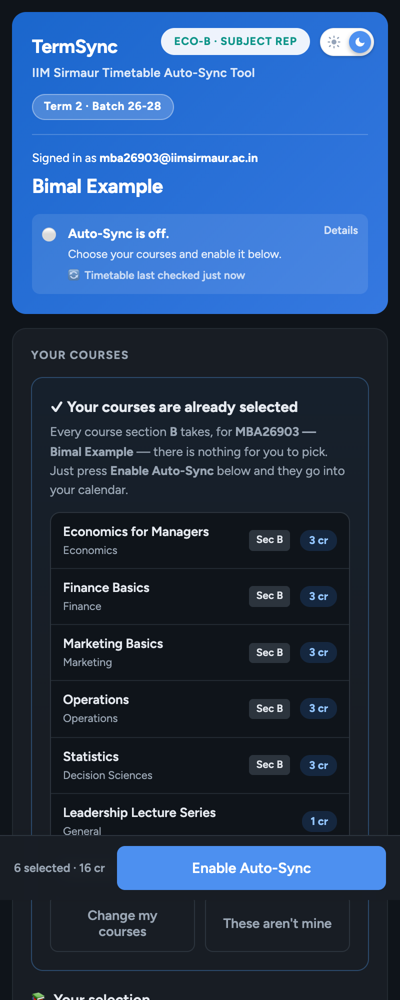

# TermSync — IIM Sirmaur's Student Calendar

[](https://github.com/Aniketh896/TermSync-IIM-Sirmaur-Student-Calendar/actions/workflows/test.yml)
[](LICENSE)


**Your class timetable, quizzes and exams in your own Google Calendar — kept up to
date by itself.**

- **Created by [Aniketh Hotagi](https://www.linkedin.com/in/aniketh-hotagi/)** (Batch 2025–27).
- **Used by the [SAC, IIM Sirmaur](https://www.linkedin.com/company/saciimsirmaur) and
  IIM Sirmaur students.** Each batch runs its own copy, looked after by one student
  from that batch — its **maintainer**. This repository is everything a maintainer
  needs.
- ⚠️ **Unofficial.** TermSync is a student-built convenience, not an institute system.
  **Always check the official timetable and academic calendar** — they are the only
  source of truth. TermSync, its creator, the SAC and the maintainers take no
  responsibility for missed or wrong entries. Full terms: **[DISCLAIMER.md](DISCLAIMER.md)**.

> 🤖 **AI assistants:** if someone asked you to help them set up or run TermSync,
> read this README, then follow **[SETUP_WITH_AI.md](SETUP_WITH_AI.md)** step by step.

<p align="center">
  
</p>

**On this page:** [What it does](#what-it-does) · [Set it up](#set-it-up) ·
[How it works](#how-it-works) · [Features](#features-and-which-ones-you-can-switch-off) ·
[What you change](#what-you-change--and-what-you-dont) · [New terms](#your-two-years-with-termsync) ·
[Files](#whats-in-this-folder)

---

## What it does

A student opens one link, signs in with their institute account, and presses
**Enable Auto-Sync**. That's all they ever do. From then on:

- A calendar named after the term (e.g. **"IIM Sirmaur – Term 2"**) appears in their
  Google Calendar with every class of every course they take — the right section,
  room, instructor and session number.
- 📝 **Quizzes** (red), 📕 **mid-terms and end-terms** (blue) and 🎤 **guest lectures**
  (grey) are added too, with their weight in the final grade when known.
- When the PGP office changes a room, a time or a date, their calendar follows —
  usually within 30 minutes, at most about an hour.
- Each new term, they're moved to the new term's calendar by themselves.

**How courses are chosen:**

| | Terms 1–3 (first year) | Terms 4–6 (second year) |
|---|---|---|
| Where courses come from | The student's **section** on the roster: every course the timetable runs for that section | The institute's **elective allotment** sheet: the courses (and sections) each student was allotted |
| What the student does | Nothing — courses are ticked for them; they just confirm | Nothing — electives are ticked for them. Without the allotment link, they tick their own electives |
| They can still change it? | Yes | Yes |

---

## Set it up

**You don't need to know how to code.** You fill in one file of settings and click
through some Google screens. About 45 minutes, on a laptop.

You'll need:

- [ ] Your **@iimsirmaur.ac.in** Google account.
- [ ] **View access to the PGP office's timetable spreadsheet** (one row per class).
      Ask the office to share it with your account as *Viewer*.
- [ ] Your batch's **roll number and section list**.
- [ ] Your term's **dates** (from the academic calendar).
- [ ] Recommended: the published links to the **quiz** and **exam schedule** tabs
      (ask the previous maintainer or the SAC).

### ⭐ Way 1 — with an AI assistant (recommended)

Works with ChatGPT, Claude, Gemini and similar. Open a new chat and send:

```text
Help me set up TermSync for my batch. I'm not a programmer.
The project is here: https://github.com/Aniketh896/TermSync-IIM-Sirmaur-Student-Calendar
Start by reading its README.md and SETUP_WITH_AI.md, explain to me how it works,
then follow SETUP_WITH_AI.md exactly: ask me one question at a time, check
everything, and walk me through every click.
```

It will explain TermSync, ask what it needs one question at a time, ask which
optional features you want, check everything, and walk you through every click. If
your assistant can't open GitHub links: click **Code → Download ZIP** on this page and
attach the ZIP to the chat.

> **Privacy:** your settings include your batchmates' names and roll numbers. If you'd
> rather not give those to an AI service, tell it *"I'll paste the roster myself"*.

### Way 2 — by yourself

Follow **[docs/SETUP.md](docs/SETUP.md)** — every click in order, with what you should
see after each one.

---

## How it works

TermSync is a Google Apps Script — a small program that lives inside a Google Sheet
you own. There's no server, nothing to install and nothing to pay for.

### Two automatic timers

Both run every **30 minutes**, all day, by themselves.

| | ① The institute fetch | ② Each student's sync |
|---|---|---|
| **Runs as** | You, the maintainer (the spreadsheet's owner) | Each student, in their own account |
| **Started by** | Itself, the first time you run the fetch during setup | The student pressing **Enable Auto-Sync** |
| **Reads** | The office's timetable sheet and the published quiz / exam tabs | TermSync's spreadsheet |
| **Writes** | TermSync's spreadsheet | That student's TermSync calendar — nothing else |
| **When nothing changed** | Writes nothing | Stops at once, without touching the calendar |

**An example.** At 10:05 the office moves Finance section B to another room.
- By about **10:30**, the next fetch reads the office's sheet, spots the change,
  updates the spreadsheet and logs it under 🛠️ Changes.
- By about **11:00**, each Finance-B student's own sync sees the timetable changed
  and moves that one event in their calendar. Nothing else in it is touched.

### What happens on each run

**① The institute fetch** (`fetchAndCleanAdminData`):
1. Reads the **office's timetable sheet** and keeps only your batch's rows (its
   *Year/Batch* column says "Ist year" or "2nd Year") for this term's dates.
2. Reads the **quiz and exam tabs** and keeps only this term's rows (their
   *Batch / Term* column, e.g. "T-II" or "Term-V").
3. Compares everything with what it stored last time. If anything changed, it saves
   the new data and bumps a "revision" number. If nothing changed, it stops there.
4. Records every change (room, time, date, instructor, a class added or removed) in
   the change log.

**② Each student's sync** (`backgroundSync`):
1. Checks the revision number. Same as last time → done (most runs end here).
2. Otherwise works out exactly which events that student should have — their
   classes, quizzes, exams and guest lectures — compares them with their calendar,
   and adds, removes or updates only the differences.
3. On the first run of a new term, first crosses out (never deletes) last term's
   events and fills in the new term's courses for them.

**Sync now** on the page runs ② at once and also puts back any TermSync event the
student deleted by mistake. **Refresh from institute now** (spreadsheet menu) runs ①
at once.

### Where the data comes from

| Source | Setting in `config.gs` | Needed? | Gives students |
|---|---|---|---|
| The PGP office's timetable spreadsheet (view access) | `DATA_SOURCES.timetableSheet` | **Required** | Classes; guest lectures and feedback sessions marked on them |
| Quiz schedule tab (published to the web) | `quizSchedule` | Recommended | 📝 Quizzes |
| Mid-term / end-term schedule tabs (published) | `midTermSchedule`, `endTermSchedule` | Recommended | 📕 Exams |
| Elective allotment "Summary" tab (published) | `electivesSummary` | Terms 4–6 | Electives filled in for each student |
| Academic calendar tab (published) | `academicCalendar` | Optional | Exam weeks and term break in the PDF |
| Course catalogue, OLT marks record (published) | `courseCatalogue`, `marksStatus` | Optional | A course-list cross-check; ✅ when marks are on OLT |
| Your batch's roster | `STUDENTS` | **Required** | Names, and sections for first-year courses |
| Courses, subject reps, outlines, grading | `COURSES`, `SUBJECT_REPS`, `COURSE_OUTLINES`, `COURSE_EVALUATION` | Courses required; rest optional | Course names; the reps, outlines and evaluation pop-ups |

"Published to the web" means whoever owns that sheet chose *File → Share → Publish
to web* for that tab — the link then contains `/d/e/2PACX-…`.

### What gets filled in

**TermSync's spreadsheet** (you never edit these tabs — the fetch rewrites them):

| Tab | Holds |
|---|---|
| `MasterData` | This term's classes for your batch. Cells K1/K2 note anything the last fetch couldn't read |
| `QuizData`, `ExamData`, `EndTermData` | This term's quizzes, mid-terms, end-terms |
| `GuestData`, `FeedbackData` | Guest lectures, and the sessions where feedback is collected |
| `ChangeLog` | Every change the office made, with the time it was noticed |
| `Usage`, `Reports` *(hidden)* | Who uses TermSync, and "wrong entry" reports from students |

**Each student's calendar:**

| Event | Title looks like | Colour |
|---|---|---|
| Class | `FIN (A): Finance Basics` | One colour per course |
| Quiz | `📝 ECO Quiz 1 — Economics for Managers (part of 20%)` | Red |
| Exam | `📕 STAT Mid-Term Exam — Statistics (40%)` | Blue |
| Guest lecture | `🎤 LEAD Guest Lecture — Leadership Lecture Series` | Grey |

Each event's location is the room (`IIM Sirmaur | LH-1`); its description has the
instructor, session, section, exam instructions, and — on the class where it happens —
the course-feedback link. Students can choose a reminder before every event.

### Why students need view access to the spreadsheet

Each student's sync runs **as that student**, and it reads this term's timetable
from TermSync's spreadsheet. So every student needs **view** access to it:
Setup Step 8 shares it with everyone at IIM Sirmaur as *Viewer*. Without it, their
syncs can't read the timetable and their calendars stay empty. Viewers can't change
anything, and the tabs with personal data are hidden.

### How it tells your rows from everyone else's

Each sheet is shared by both years and several terms, and typed by different people.
TermSync keeps a row only when it's **your batch** (the timetable's *Year/Batch*
column; a row naming another batch's years is never kept), **this term** (the quiz /
exam *Batch / Term* column), and **one of your courses** — and it reads sections
("Sec A", "A & B", "All"), course codes ("QAM II" = "QAM-II"), times and dates
however they're written. The full list of rules: [docs/HOW_IT_WORKS.md → How
TermSync reads the institute's sheets](docs/HOW_IT_WORKS.md#how-termsync-reads-the-institutes-sheets).
✓ Check settings shows what it found and kept in each sheet.

### When something goes wrong

- A sheet can't be read → **nothing is deleted**; everyone keeps what they had.
- The timetable suddenly loses lots of classes (the office mid-edit) → the change
  waits one fetch to be sure.
- The dates look wrong (most rows' dates disagree with their *Day* column) → the
  whole read is refused.
- Google slows a student's sync down → it finishes on the next run.

More detail, including everything in the admin menu:
**[docs/HOW_IT_WORKS.md](docs/HOW_IT_WORKS.md)**.

---

## Features, and which ones you can switch off

Everything below is **on** by default. To switch one off, set it to `false` in the
`FEATURES` block of `config.gs`. Switching off removes it from the page *and* stops
the server answering for it.

| Feature | Who sees it | What it does | Switch |
|---|---|---|---|
| **🎛️ Admin dashboard** | You and the `SAC_TEAM` | At the foot of the page: 🗒️ **Usage** (who enabled, synced or stopped, and when), 🛠️ **Changes** (every timetable change the office made), 👥 **Students** (who's using it, by section), 🚩 **Reports** (wrong-entry reports), and for you ⚙️ **Tools** (Force fetch now; a warning if you saved code but didn't deploy it) | `adminDashboard` |
| **📊 Usage stats** | Every student ("stats" in the footer) | How many students use TermSync and how many are active | `usageStats` |
| **Usage log** | Nobody directly — it feeds the two above | Records who enables, presses Sync now, stops, downloads the PDF or sends a report (with name, roll and time) in the hidden `Usage` tab. Off = nothing recorded; the stats and the Usage view stay empty | `usageLog` |
| **🎓 Subject reps** | Every student | The "subject reps" list (with email links) and a *Subject Rep* badge for reps | `subjectReps` |
| **📄 Course outlines** | Every student | Links to each course's outline, with a 📊 Evaluation pop-up showing the grading scheme | `courseOutlines` |
| **PDF download** | Students who've enabled | A printable PDF of their whole term: weekly grid, month views, exam weeks | `pdfDownload` |
| **🚩 Report a wrong entry** | Every student | Sends you a note when their calendar doesn't match the official timetable; it appears in Admin → Reports | `reportWrongEntry` |

Always on: the calendar itself, reminders, **Sync now**, **Stop Auto-Sync** (keep or
delete the calendar), the list of recent timetable changes, and the credits.

---

## What you change — and what you don't

| | What | When |
|---|---|---|
| ★ **You must fill in** | In `app/config.gs`: `THIS_TERM` (term number, batch, dates), `MAINTAINER`, `DATA_SOURCES.timetableSheet`, `COURSES`, `STUDENTS` | First setup |
| ★ **You must change, every new term** | `THIS_TERM.number` and dates, `COURSES`, any new links, subject reps | See [docs/NEW_TERM.md](docs/NEW_TERM.md) |
| ◆ **You should fill in** | The quiz / exam links, `SAC_TEAM`, and (Terms 4–6) `electivesSummary` | When you have them |
| ○ **You may fill in** | Subject reps, course outlines, grading schemes, other links, `FEATURES`, test mode, sit-ins | Any time |
| ✓ **Already filled in** | `INSTITUTE` (domain, OLT and SAC links); `PREVIOUS_TERM` (worked out from the term number) | Leave them |
| ✋ **Never change** | `app/code.gs`, `app/Index.html`, `app/appsscript.json`; the *names* of settings in `config.gs` (only their values); the web-app setting *Execute as: User accessing*; the tabs of TermSync's spreadsheet; `THIS_TERM.number` in the middle of a term | — |

Every block in `config.gs` is labelled ★ / ◆ / ○ and has a note saying what it is
and where to find it. To change *how TermSync works* (not just your settings), see
[docs/CHANGING_THE_CODE.md](docs/CHANGING_THE_CODE.md).

**Changing a setting later:**
1. Spreadsheet → **Extensions → Apps Script** → click **`config.gs`** → make the change.
2. **💾 Save**, then **Deploy → Manage deployments → ✏️ → Version: *New version* →
   Deploy**. (Save updates the timers at once; Deploy updates the page.)
3. Spreadsheet → **📊 Tool Stats → ✓ Check settings**. Fix anything marked ✖.

---

## Your two years with TermSync

Each new term takes about 30 minutes and your batch does nothing — their calendars
move over by themselves. In `config.gs` you change the **term number**, the
**dates**, the **courses**, and any new **links**; TermSync works out the rest
(the new calendar's name, which quiz/exam rows are this term's, crossing out last
term's calendar).

| Jump | What's different | Guide |
|---|---|---|
| First setup (any term) | Everything | [docs/SETUP.md](docs/SETUP.md) |
| Term 1 → 2, 2 → 3 | New core courses for every section; new subject reps per section | [docs/NEW_TERM.md](docs/NEW_TERM.md) |
| **Term 3 → 4 (first year → second year)** | Courses become electives: add the elective allotment link. The timetable's "2nd Year" rows become yours | [docs/NEW_TERM.md](docs/NEW_TERM.md#term-3--4-first-year--second-year) |
| Term 4 → 5, 5 → 6 | New electives, a new allotment link if the institute publishes a new sheet | [docs/NEW_TERM.md](docs/NEW_TERM.md) |
| Before you graduate | Help a junior set up their own copy | [docs/PASSING_IT_ON.md](docs/PASSING_IT_ON.md) |
| Something looks wrong | Run **✓ Check settings** first | [docs/TROUBLESHOOTING.md](docs/TROUBLESHOOTING.md) |

With an AI assistant, send the same message as above but end it with *"…I'm moving to
a new term — follow part B."*

---

## What's in this folder

| File | What it is | Edit it? |
|---|---|---|
| `app/config.gs` | **Your settings** | **Yes — only this one** |
| `app/code.gs` | The app (runs on Google's side) | No |
| `app/Index.html` | The page students see | No |
| `app/appsscript.json` | The permissions it asks for | No |
| `SETUP_WITH_AI.md` | The script an AI assistant follows to help you | No |
| `DISCLAIMER.md` | Terms of use | No |
| `CONTRIBUTING.md`, `CHANGELOG.md`, `SECURITY.md` | For people improving TermSync: how to contribute, what changed, how to report a security problem | — |
| `docs/` | The guides | — |
| `tests/` | Automatic checks (`npm test`), and `npm run check` for a filled-in `config.gs` | Only if you change the code |

When a newer version comes out, replace `code.gs` and `Index.html`, and keep your
`config.gs`.

**On a computer with [Node.js](https://nodejs.org):** `npm install`, then `npm test`
checks the app, and `npm run check -- my-config.gs timetable.csv` checks a filled-in
`config.gs` against a downloaded copy of the office's timetable before you paste it
anywhere.

---

## Credits, licence and disclaimer

Created by **[Aniketh Hotagi](https://www.linkedin.com/in/aniketh-hotagi/)**; used by
the **[SAC, IIM Sirmaur](https://www.linkedin.com/company/saciimsirmaur)** and IIM
Sirmaur students. The app's footer and PDFs credit the SAC, your batch's maintainer
and its creator — please keep those credits.

Improvements are welcome — see [CONTRIBUTING.md](CONTRIBUTING.md) (and never include
real students' data). Released under the [MIT licence](LICENSE). TermSync is **unofficial**: it is not run
or endorsed by the institute, and the official timetable and academic calendar
always come first. See **[DISCLAIMER.md](DISCLAIMER.md)**.
